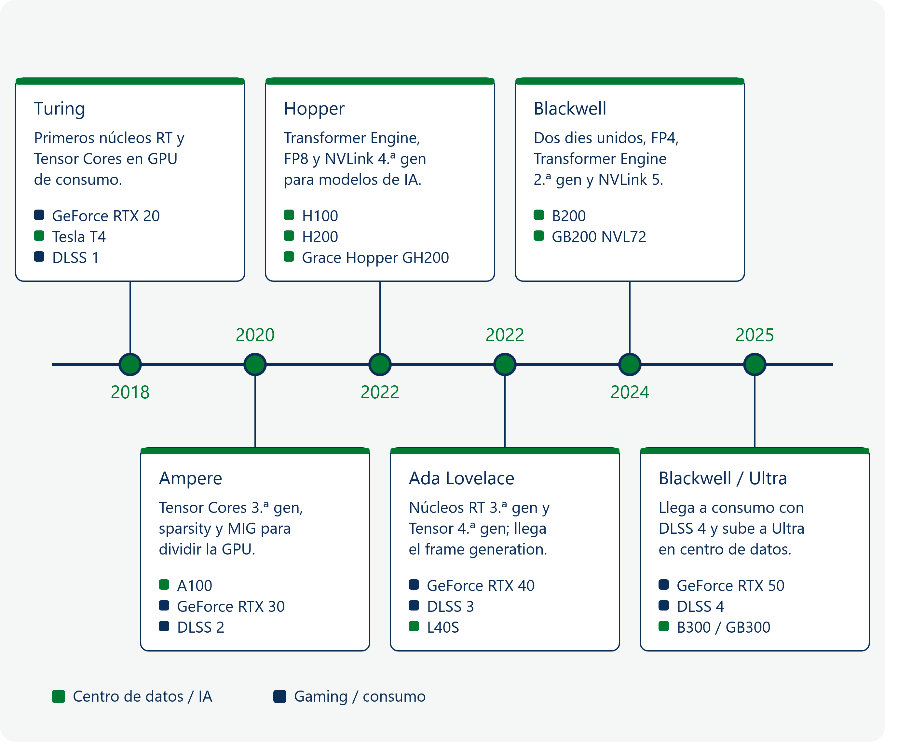

# Evolución de la Arquitectura NVIDIA

<a href="index.html" style="display: inline-block; padding: 10px 15px; background-color: #0b2e59; color: white; text-decoration: none; border-radius: 5px; font-weight: bold; margin-bottom: 20px;">⬅ Volver al Inicio</a>

  <h2>2018 - 2025</h2>
  
Línea de tiempo de las arquitecturas NVIDIA

## Información General
La RTX 5060 no es un producto aislado; es el resultado de más de una década de evolución. Cada generación de arquitectura NVIDIA introdujo innovaciones clave que, acumuladas, dan forma a la GPU que estudiamos. 

---

## Explicación Detallada

  
👉 Haz clic aquí para ver la Línea de Tiempo completa

  

    <table style="width:100%; border-collapse: collapse;">
      <tr style="background-color: #0b2e59; color: white;">
        <th style="padding: 10px; border: 1px solid #ddd;">Año</th>
        <th style="padding: 10px; border: 1px solid #ddd;">Arquitectura</th>
        <th style="padding: 10px; border: 1px solid #ddd;">Hito Principal</th>
      </tr>
      <tr>
        <td style="padding: 10px; border: 1px solid #ddd;"><strong>2018</strong></td>
        <td style="padding: 10px; border: 1px solid #ddd;"><strong>Turing</strong></td>
        <td style="padding: 10px; border: 1px solid #ddd;">Introdujo los <strong>primeros RT Cores</strong> y los <strong>Tensor Cores de 2.ª gen</strong>. Se añadió la caché unificada por primera vez.</td>
      </tr>
      <tr style="background-color: #f9f9f9;">
        <td style="padding: 10px; border: 1px solid #ddd;"><strong>2020</strong></td>
        <td style="padding: 10px; border: 1px solid #ddd;"><strong>Ampere</strong></td>
        <td style="padding: 10px; border: 1px solid #ddd;">Duplicó el rendimiento de FP32, introdujo los <strong>Tensor Cores de 3.ª gen</strong> y una <strong>gran caché L2</strong>.</td>
      </tr>
      <tr>
        <td style="padding: 10px; border: 1px solid #ddd;"><strong>2022</strong></td>
        <td style="padding: 10px; border: 1px solid #ddd;"><strong>Ada Lovelace</strong></td>
        <td style="padding: 10px; border: 1px solid #ddd;">Llevó los <strong>RT Cores de 3.ª gen</strong> y los <strong>Tensor Cores de 4.ª gen</strong> (soporte FP8), habilitando el <strong>DLSS 3</strong>.</td>
      </tr>
      <tr style="background-color: #f9f9f9;">
        <td style="padding: 10px; border: 1px solid #ddd;"><strong>2025</strong></td>
        <td style="padding: 10px; border: 1px solid #ddd;"><strong>Blackwell</strong></td>
        <td style="padding: 10px; border: 1px solid #ddd;">La arquitectura de la RTX 5060. Introduce los <strong>Tensor Cores de 5.ª gen</strong> (soporte nativo FP4 y FP6) y los <strong>RT Cores de 4.ª gen</strong>. Optimizada para el <strong>DLSS 4</strong> y el renderizado neuronal.</td>
      </tr>
    </table>
  

  
👉 Haz clic aquí para leer: ¿Qué hace especial a Blackwell?

  

    La RTX 5060 hereda lo mejor de sus predecesoras, pero su gran salto está en la <strong>integración de la IA en el proceso de renderizado</strong>. Mientras que en generaciones anteriores la IA se usaba principalmente para el reescalado (DLSS), en Blackwell la IA participa en la propia generación de geometría y texturas (Neural Shading).  
    Además, sus Tensor Cores de 5.ª generación son los primeros en soportar de forma nativa el formato <strong>FP4</strong> (coma flotante de 4 bits). Esto duplica la velocidad de procesamiento para IA en comparación con FP8, manteniendo una precisión aceptable para muchas tareas, lo que es clave para el DLSS 4 y las aplicaciones de IA generativa.
  

