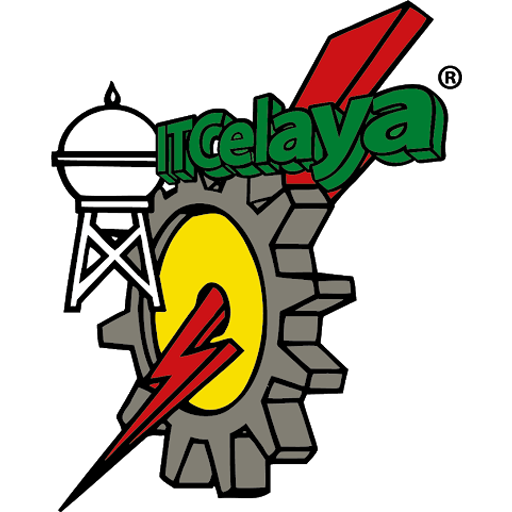

# Flujo de Trabajo y Procesos

  

    
    
  

  <a href="index.html" class="btn-volver">⬅ Volver al Inicio</a>

  <h2>4 Fases</h2>
  
El viaje del dato: del CPU a la pantalla

## Información General
Para entender la arquitectura, es útil seguir el "viaje" de un dato. El proceso se puede dividir en dos grandes vertientes que trabajan en conjunto: el **procesamiento gráfico tradicional** y el **procesamiento de IA**. 

---

## Explicación Detallada

  
👉 Fase 1 y 2: Preparación y Procesamiento en los SMs

  

    <strong>Fase 1: Preparación y Distribución</strong> 
    1. El CPU envía al GPU los datos de la escena (vértices, texturas, instrucciones) a través del bus PCIe 5.0. 
    2. Los datos llegan a la memoria GDDR7. 
    3. El motor de distribución de trabajo (GigaThread Engine) del GPU asigna las tareas a los GPCs.  
    <strong>Fase 2: Procesamiento en los SMs</strong> 
    Dentro de cada SM, los datos fluyen a través de un "pipeline" (tubería): 
    1. <strong>Vertex Shading:</strong> Los Núcleos CUDA transforman los modelos 3D en coordenadas de pantalla. 
    2. <strong>Rasterización:</strong> El Polymorph Engine y los RT Cores (si el juego usa Ray Tracing) convierten las formas geométricas 3D en píxeles 2D. 
    3. <strong>Pixel Shading:</strong> Los Núcleos CUDA calculan el color final de cada píxel, aplicando texturas e iluminación.
  

  
👉 Fase 3: La Intervención de la IA (El diferenciador de Blackwell)

  

    En lugar de renderizar todos los píxeles a la máxima resolución, el proceso se optimiza drásticamente:  
    *   <strong>DLSS Super Resolution:</strong> La GPU renderiza la imagen a una resolución menor (ej. 1080p) y los Tensor Cores utilizan IA para reconstruirla a una resolución mayor (4K) con una calidad casi idéntica. 
    *   <strong>Generación de Fotogramas (DLSS 4):</strong> Los Tensor Cores analizan dos fotogramas consecutivos y generan un fotograma intermedio completamente nuevo mediante IA. Esto duplica o triplica la tasa de FPS sin que los Núcleos CUDA tengan que renderizar ese trabajo adicional. 
    *   <strong>Neural Shading:</strong> La IA también participa en el sombreado, mejorando la calidad de los materiales (RTX Neural Materials).
  

  
👉 Fase 4: Salida a Pantalla

  

    Finalmente, los <strong>ROPs (Raster Operations)</strong> aplican efectos de posprocesamiento (como antialiasing) y envían la imagen final a los controladores de memoria para que se muestre en el monitor a través de los puertos <strong>HDMI 2.1b</strong> o <strong>DisplayPort 2.1b</strong>.
  

