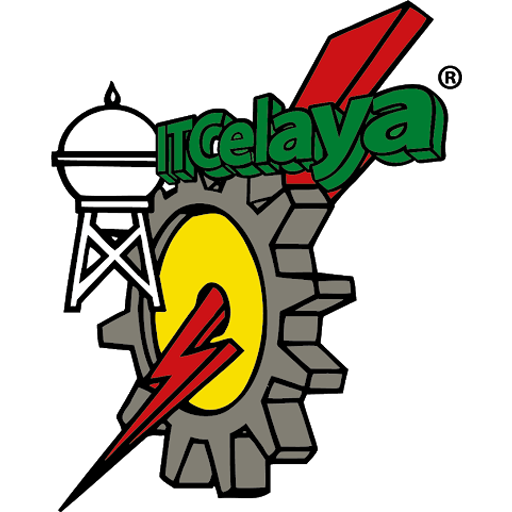
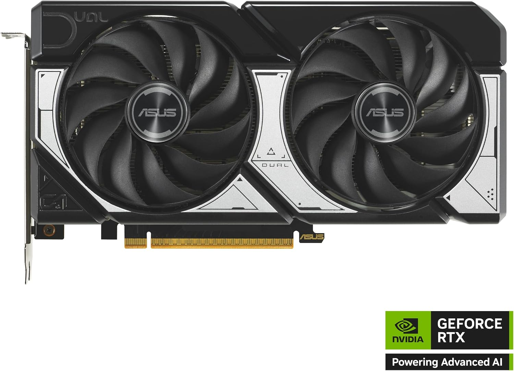

# Arquitectura de la GPU NVIDIA RTX 5060 (8 GB GDDR7)

  
  

  <h1>Arquitectura de la GPU NVIDIA RTX 5060</h1>
  
Proyecto de Maqueta y Documentación Técnica - Arquitectura de Computadoras

  

## Resumen del Proyecto

Bienvenido a la plataforma interactiva de la maqueta sobre la **NVIDIA GeForce RTX 5060**, basada en la arquitectura **NVIDIA Blackwell**. Esta documentación ha sido diseñada para complementar el modelo físico, permitiendo a los usuarios escanear los códigos QR y explorar el detalle técnico de cada componente.

  <a href="cuda.html" class="card">
    <h3>🧠 Núcleos CUDA</h3>
    
El motor principal del procesamiento gráfico. Descubre cómo operan los 3,840 núcleos de la RTX 5060.

  </a>

  <a href="tensor.html" class="card">
    <h3>🤖 Tensor Cores</h3>
    
La potencia detrás de la inteligencia artificial, el DLSS 4 y el rendimiento de 614 AI TOPS.

  </a>

  <a href="rt.html" class="card">
    <h3>💡 RT Cores</h3>
    
El hardware dedicado al trazado de rayos en tiempo real y la tecnología Mega Geometry.

  </a>

  <a href="memoria.html" class="card">
    <h3>⚡ Memoria y Conexión</h3>
    
El subsistema de memoria GDDR7, el ancho de banda de 448 GB/s y la interfaz PCIe 5.0.

  </a>

  <a href="jerarquia.html" class="card">
    <h3>🏗️ Jerarquía Interna</h3>
    
Cómo se organizan los componentes internamente: GPC, TPC y los 30 SMs de la tarjeta.

  </a>

  <a href="flujo-trabajo.html" class="card">
    <h3>🔄 Flujo de Trabajo</h3>
    
El viaje de un dato: desde que el CPU envía la instrucción hasta la renderización en pantalla.

  </a>

  <a href="evolucion.html" class="card">
    <h3>🕰️ Evolución Histórica</h3>
    
El camino de NVIDIA desde Turing hasta Blackwell y cómo llegamos a esta arquitectura.

  </a>

 

  
<strong>Tecnológico Nacional de México - Campus Celaya</strong> 
  Departamento de Sistemas y Computación

