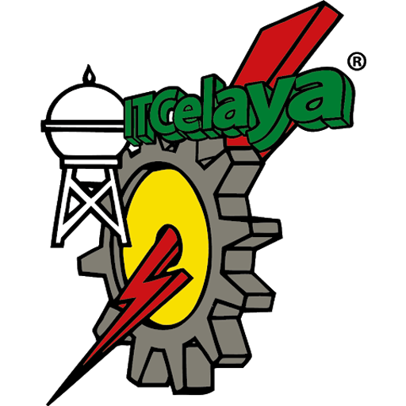

# RT Cores (4.ª Generación)

  

    
    
  

  <a href="index.html" class="btn-volver">⬅ Volver al Inicio</a>

  <h2>58 TFLOPS</h2>
  
Potencia para Trazado de Rayos

## Información General
Los **RT Cores** (Ray Tracing Cores) son unidades de hardware dedicadas exclusivamente a calcular el trazado de rayos en tiempo real. La RTX 5060 equipa la **4.ª Generación** de estos núcleos, alcanzando una potencia de **58 TFLOPS**.

---

## Explicación Detallada

  
👉 Haz clic aquí para entender el Ray Tracing y el problema del hardware tradicional

  

    <strong>¿Qué es el Ray Tracing?</strong> 
    El trazado de rayos es una técnica de renderizado que simula el comportamiento físico real de la luz. Se lanzan "rayos" virtuales desde la cámara hacia la escena para calcular cómo rebotan en los objetos.  
    <strong>El problema del hardware tradicional:</strong> 
    Hacer esto con Núcleos CUDA tradicionales requiere una cantidad enorme de cálculos, lo que haría que los juegos corrieran a muy pocos FPS (fotogramas por segundo).
  

  
👉 Haz clic aquí para leer sobre la solución de los RT Cores y Mega Geometry

  

    <strong>La solución de los RT Cores:</strong> 
    Los RT Cores calculan intersecciones de rayos con triángulos (la base de los modelos 3D) de forma ultrarrápida. Esto permite que juegos como <i>Cyberpunk 2077</i> o <i>Alan Wake 2</i> tengan reflejos precisos en el agua, sombras realistas y refracciones de luz sin que la tarjeta colapse.  
    <strong>Mega Geometry:</strong> 
    La arquitectura Blackwell introduce <strong>Mega Geometry</strong>, una tecnología que permite a los RT Cores manejar escenas con una cantidad masiva de geometría (como los micromodelos de <i>Unreal Engine 5 Nanite</i>), acelerando el trazado de rayos en escenas complejas sin penalizar el rendimiento.
  

